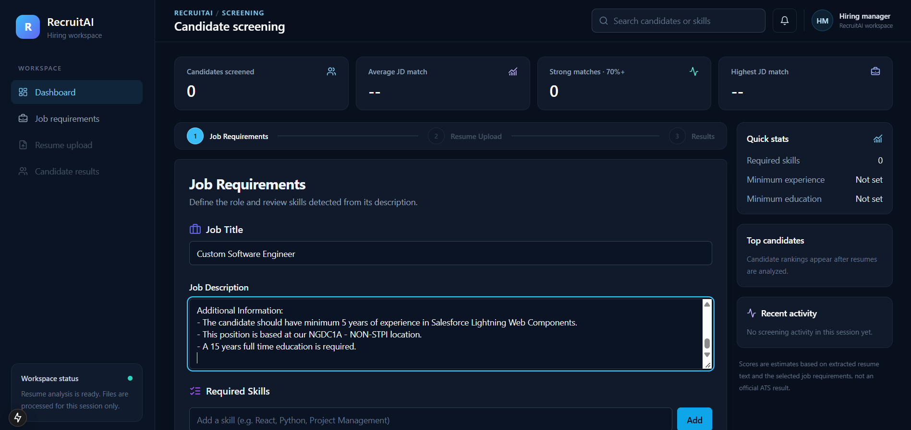
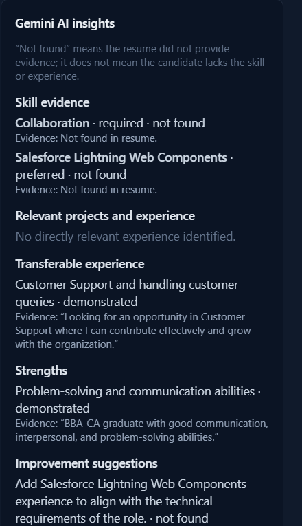
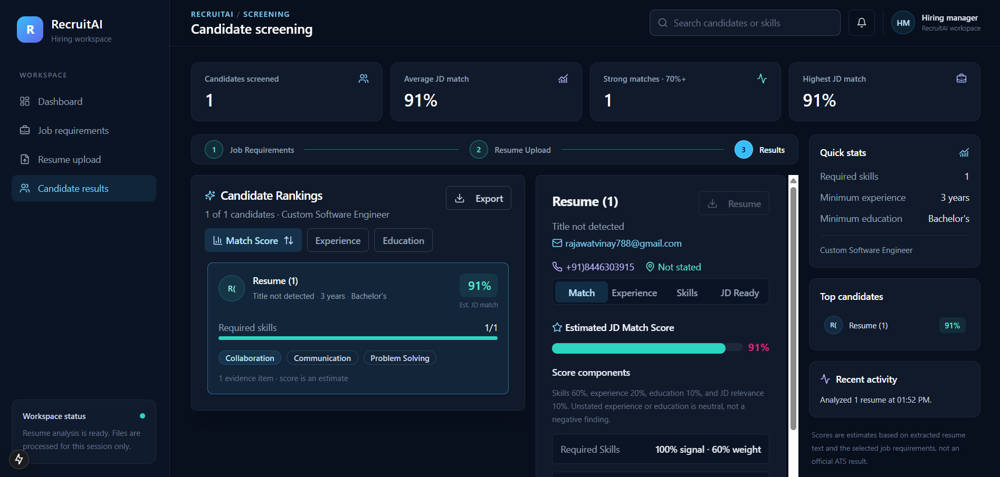
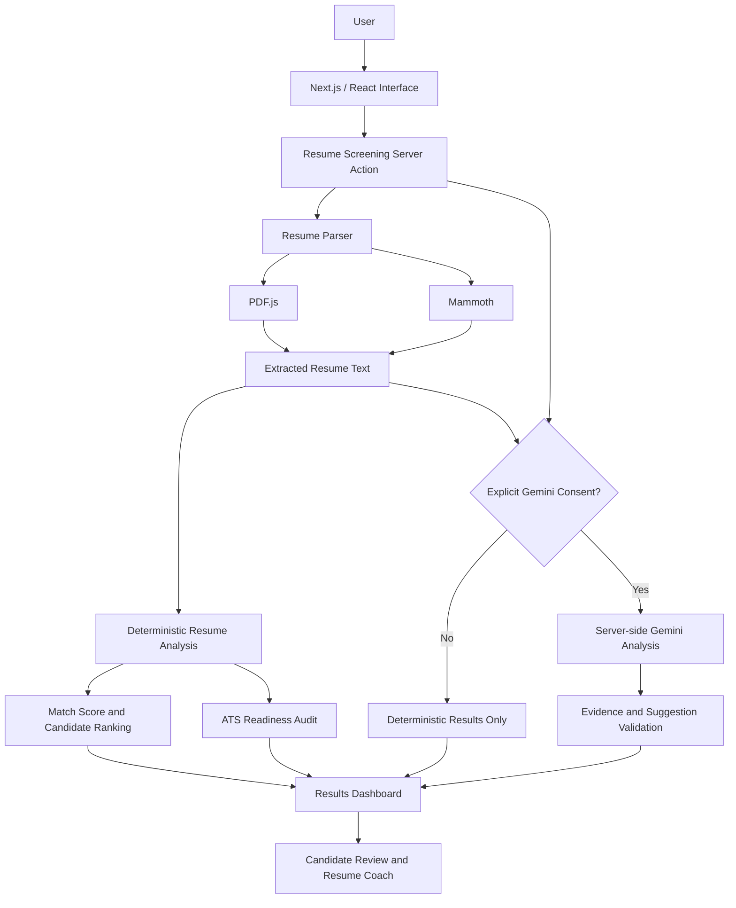
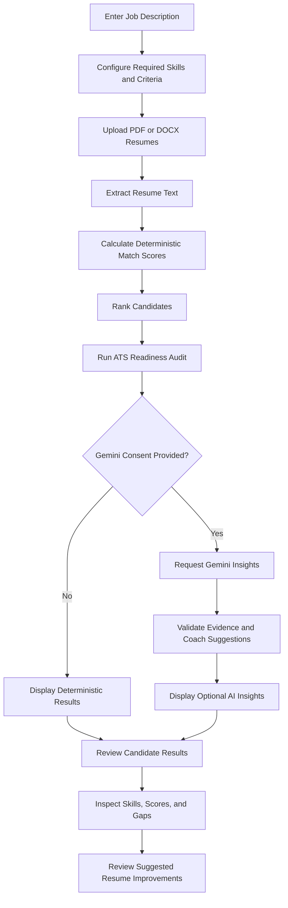

# RecruitAI — AI-Powered Resume Screening & Ranking System

An intelligent resume screening application that evaluates resumes against job descriptions, calculates candidate match scores, ranks applicants, and optionally generates evidence-based insights using Google Gemini AI.

RecruitAI combines deterministic resume analysis with consent-gated generative AI to help users understand candidate-job alignment, identify missing skills, review ATS-readiness signals, and explore potential resume improvements.


## 📌 Table of Contents

- [Overview](#-overview)
- [Key Features](#-key-features)
- [Technology Stack](#-technology-stack)
- [System Architecture](#-system-architecture)
- [Application Workflow](#-application-workflow)
- [Scoring Methodology](#-scoring-methodology)
- [Getting Started](#-getting-started)
- [How to Use](#-how-to-use)
- [Project Structure](#-project-structure)
- [Privacy and Security](#-privacy-and-security)
- [Limitations](#-limitations)
- [Testing and Validation](#-testing-and-validation)
- [Future Improvements](#-future-improvements)
- [Demo Video](#-demo-video)
- [Contributing](#-contributing)
- [License](#-license)
- [Acknowledgements](#-acknowledgements)

---

## 🚀 Overview

RecruitAI is a resume screening and ranking system designed to help evaluate how closely candidate resumes align with a given job description.

The application extracts text from supported resume formats, evaluates candidates against configurable job requirements, calculates deterministic match scores, and ranks candidates based on those scores.

For users who explicitly consent, RecruitAI can also use Google Gemini to generate additional skill evidence, related terminology, project context, and resume-improvement suggestions.

The system keeps deterministic scoring separate from generative AI insights, allowing users to review the scoring results independently of optional AI-generated recommendations.

### Why RecruitAI?

Recruiters and job seekers often need to compare multiple resumes against specific job requirements. Manually reviewing every resume can be time-consuming, and relevant skills may be expressed using different terminology.

RecruitAI aims to simplify this process by providing:

- A consistent approach to resume and job-description comparison.
- A ranked view of candidates based on a transparent scoring formula.
- An overview of skills, experience, education, and job-description relevance.
- An ATS-readiness audit based on observable signals in extracted resume text.
- Optional AI-generated insights with evidence validation and resume-coaching suggestions.

RecruitAI is a portfolio project and decision-support tool. Its results should be reviewed by a human and should not be treated as a hiring decision.

---

## ✨ Key Features

### 1. Resume Upload and Text Extraction

- Supports text-based PDF resumes using PDF.js.
- Supports DOCX resumes using Mammoth.
- Extracts resume text for subsequent analysis.
- Allows multiple candidates to be compared against job requirements.
- Does not currently perform OCR on image-only PDFs.

### 2. Job Description Analysis

- Accepts a job title and job description.
- Supports configurable required skills.
- Supports minimum experience and education requirements.
- Uses job-description terms to evaluate candidate relevance.

### 3. Deterministic Resume Scoring

- Calculates a candidate match score using a defined scoring formula.
- Evaluates required skills, experience, education, and job-description relevance.
- Presents score components to help users understand candidate alignment.
- Ranks candidates by deterministic match score in descending order.

### 4. ATS-Readiness Audit

Examines extracted resume text for observable signals such as:

- Contact information.
- Common resume section headings.
- Dates and employment-related information.
- Required job-description terms.
- Potential extraction or formatting risks visible in the extracted text.

The audit provides useful checks, but it does not reproduce a proprietary Applicant Tracking System (ATS).

### 5. Optional Gemini AI Insights

With explicit user consent, RecruitAI can request additional analysis from Google Gemini.

Depending on the available evidence and implemented validation, insights may include:

- Evidence associated with relevant skills.
- Related terminology that may be relevant to the job description.
- Project context and potentially relevant experience.
- Suggestions for improving resume content.
- Explanations and evidence-based recommendations for further review.

Gemini insights are separate from the deterministic match score.

### 6. Evidence-Based Resume Coach

- Reviews proposed resume improvements alongside the original extracted text.
- Uses evidence validation to help prevent unsupported claims.
- Uses confirmation placeholders when information is missing.
- Allows users to review proposed edits before accepting them.
- Keeps accepted edits as a local draft in the current view; it does not modify or save the uploaded resume file.

### 7. Candidate Ranking and Results

- Displays candidate results based on deterministic scores.
- Supports comparison against configured job requirements.
- Helps users identify relevant skills and possible gaps.
- Provides optional Gemini insights when consent is provided and the service is available.

---

## 📸 Screenshots
### Dashboard


### Resume Analysis


### Candidate Ranking



## 🛠️ Technology Stack

| Category | Technologies |
|---|---|
| Frontend framework | Next.js |
| UI library | React |
| Programming language | TypeScript |
| Styling | Tailwind CSS |
| UI components | shadcn/ui and Radix UI |
| Animations | Framer Motion |
| Resume parsing | PDF.js and Mammoth |
| Optional generative AI | Google Gemini |
| Gemini SDK | `@google/genai` |
| Testing | Repository-configured test framework |
| Development environment | Node.js and npm |

---

## 🏗️ System Architecture

The application separates the user interface, resume extraction, deterministic analysis, ATS-readiness auditing, and optional Gemini-based analysis.



### Architecture Principles

- **Separation of responsibilities:** Resume extraction, deterministic scoring, ATS auditing, and optional AI analysis have distinct responsibilities.
- **Deterministic baseline:** Candidate scores and ranking do not depend on Gemini-generated scores.
- **Consent-gated AI:** Gemini analysis requires explicit user consent.
- **Server-side API access:** The Gemini API key is configured for server-side use.
- **Human review:** Users remain responsible for reviewing scores, evidence, and suggested resume changes.

---

## 🔄 Application Workflow



### Workflow Summary

1. The user enters a job description and configures the required criteria.
2. The user uploads supported resume files.
3. The application extracts selectable text from each resume.
4. Deterministic analysis calculates match scores and ranks candidates.
5. The ATS-readiness audit evaluates observable signals in the extracted text.
6. If the user has explicitly consented, the application requests optional Gemini insights.
7. The user reviews candidate results and any proposed resume improvements.

---

## 📊 Scoring Methodology

RecruitAI uses a deterministic scoring formula to estimate how closely a resume aligns with the configured job requirements.

| Scoring component | Weight |
|---|---:|
| Required skills | 60% |
| Experience | 20% |
| Education | 10% |
| Job-description relevance | 10% |
| **Total** | **100%** |

**Formula:**

```text
Match Score =
    (Required Skills Score × 0.60)
  + (Experience Score × 0.20)
  + (Education Score × 0.10)
  + (Job Relevance Score × 0.10)
```

Each component is evaluated by the application's implemented scoring logic. Candidate ranking is based on the resulting deterministic match score, in descending order.

### Important Scoring Notes

- The match score is a heuristic, not a probability of getting hired.
- A higher score indicates stronger alignment with the configured criteria, not guaranteed suitability.
- The score is not generated by Gemini.
- Results depend on the quality of the job description, configured requirements, and extracted resume text.
- Equivalent skills expressed using different terminology may not always be recognized by deterministic matching.
- Human review is necessary before making recruitment decisions.

---

## 💻 Getting Started

Follow these instructions to run RecruitAI locally.

### Prerequisites

Install the following:

- Node.js 18 or later, or the version required by the project's dependencies.
- npm.
- Git.
- A code editor such as Visual Studio Code.

Optional:

- A Google AI Studio API key for Gemini-powered insights.

### 1. Clone the Repository

Replace the example URL with your actual GitHub repository URL.

```bash
git clone <YOUR_GITHUB_REPOSITORY_URL>
cd <YOUR_PROJECT_DIRECTORY>
```

### 2. Install Dependencies

```bash
npm install
```

If npm reports the existing `date-fns` / `react-day-picker` peer dependency conflict, use the project's previously tested installation command:

```bash
npm install --legacy-peer-deps
```

### 3. Configure Environment Variables

Create a `.env.local` file in the project root if you want to use Gemini-powered insights.

```env
GEMINI_API_KEY=your_google_ai_studio_api_key
GEMINI_MODEL=your_supported_gemini_model
```

Use a supported model name for `GEMINI_MODEL`, or omit the optional variable if the application already provides a default.

**Security requirements:**

- Never commit `.env.local` to Git.
- Never expose the API key through a `NEXT_PUBLIC_*` environment variable.
- Configure the key only in a trusted local or server-side environment.
- Do not paste your real API key into the README or screenshots.

Without Gemini configuration, the deterministic screening features should remain available, provided the application is configured to handle the missing optional AI service.

### 4. Start the Development Server

```bash
npm run dev
```

### 5. Open the Application

Visit:

[http://localhost:3000](http://localhost:3000)

---

## 📖 How to Use RecruitAI

### Step 1: Define Job Requirements

- Enter the job title and job description.
- Configure required skills.
- Set the minimum experience and education requirements supported by the interface.

### Step 2: Upload Resumes

- Upload supported text-based PDF or DOCX resumes.
- Check that the extracted resume content is readable.
- Understand that image-only PDFs are not OCR-processed.

### Step 3: Choose Whether to Use Gemini

- Gemini consent is optional and unchecked by default.
- Without consent, the application performs deterministic analysis.
- If consent is provided, extracted resume text and the selected job description may be sent to Google Gemini for additional analysis.

### Step 4: Analyze Candidates

Review the generated candidate scores and ranking. Inspect the available score components and ATS-readiness audit to understand how each resume aligns with the job requirements.

### Step 5: Review AI Insights and Resume Suggestions

When Gemini analysis is enabled and succeeds:

- Review relevant skill evidence and additional terminology.
- Inspect suggestions alongside the original extracted resume text.
- Verify every recommendation before using it.
- Treat proposed edits as drafts rather than verified facts.

---

## 📂 Project Structure

The following is a high-level representation of the project. Exact filenames and directories may vary depending on the current repository.

```text
RecruitAI/
├── app/
│   ├── layout.tsx
│   └── page.tsx
├── components/
│   ├── candidate-detail.tsx
│   ├── candidate-results.tsx
│   ├── job-requirements-form.tsx
│   ├── resume-screening-dashboard.tsx
│   ├── resume-uploader.tsx
│   └── ui/
├── lib/
│   ├── ats-readiness-audit.ts
│   ├── gemini-resume-insights.ts
│   ├── resume-analysis.ts
│   ├── resume-analyzer.ts
│   ├── resume-parser.ts
│   └── types.ts
├── public/
├── docs/
│   └── screenshots/
├── .env.example
├── .gitignore
├── package.json
├── README.md
└── ...
```

*This structure is illustrative. Keep only the paths and filenames that actually exist in your repository.*

---

## 🔐 Privacy and Security

RecruitAI processes resumes that may contain personally identifiable information. Privacy and consent are important when using the application.

### Gemini Consent

- Gemini analysis is optional.
- The consent checkbox should remain unchecked by default.
- The server action and Gemini helper should enforce consent before making an API request.
- When consent is provided, extracted resume text and the selected job description are sent to Google Gemini for the requested insights.
- Users should understand what information will be shared before enabling the feature.

### API Key Protection

- The Gemini API key belongs in a server-side environment variable.
- Do not expose secrets in client-side code.
- Keep local environment files out of version control.
- Rotate the key if it is accidentally exposed.

### Data Handling

- Review the application's implementation and hosting configuration before processing real candidate data.
- Check logs, error-reporting systems, provider retention policies, and deployment settings for possible exposure of sensitive information.
- Review Google's current API data-handling terms before using real resumes.
- Do not use sensitive candidate information unnecessarily.

### Human Oversight

RecruitAI is intended to assist with reviewing resumes. It should not be used as the sole basis for employment decisions. Review the original resume and verify important claims independently.

---

## ⚠️ Limitations

- **No OCR:** Image-only PDFs are not OCR-processed.
- **Extraction quality:** Complex layouts, columns, tables, and unusual formatting can affect extracted text.
- **Heuristic scoring:** Match scores are based on a defined formula and may not capture the full meaning of a candidate's experience.
- **Terminology differences:** Deterministic matching may miss equivalent skills described using different words.
- **ATS audit scope:** The audit examines extracted text and observable signals; it does not replicate a proprietary ATS.
- **No hiring guarantee:** Scores cannot guarantee shortlisting, interview selection, or job offers.
- **AI reliability:** Gemini can generate inaccurate or incomplete suggestions despite evidence validation.
- **Resume editing:** Proposed improvements are drafts; accepting them does not edit or save the original uploaded file.
- **External AI processing:** If consent is provided, resume text and the job description are sent to Google Gemini.
- **Provider availability:** Gemini insights may be unavailable due to configuration, connectivity, API limits, or provider errors.

---

## 🧪 Testing and Validation

Run the following checks when supported by the current repository configuration.

### Run Tests

```bash
npm test
```

### TypeScript Validation

```bash
npx tsc --noEmit --pretty false
```

### Production Build

```bash
npm run build
```

### Suggested Manual Test Cases

- Upload a valid text-based PDF resume.
- Upload a valid DOCX resume.
- Compare multiple resumes against the same job description.
- Verify that ranking follows the deterministic match scores.
- Check behavior when resume text extraction fails.
- Run screening without Gemini consent.
- Run Gemini analysis after explicitly granting consent.
- Check behavior when the API key is missing or the Gemini request fails.
- Verify that AI-generated evidence and resume suggestions are reviewed and validated.
- Confirm that the original uploaded resume is not modified when a draft is accepted.

Run only the commands supported by the repository, and report test results accurately.

---

## 🔮 Future Improvements

Potential enhancements for future versions include:

- OCR support for scanned resumes.
- Improved semantic skill matching and terminology normalization.
- More detailed explanations of individual score components.
- Expanded resume-format compatibility.
- Additional evaluation datasets and scoring validation.
- Accessibility and usability improvements.
- More comprehensive automated tests.
- Configurable AI providers with transparent consent and data-handling controls.
- Exportable screening reports, if added with appropriate privacy safeguards.

These are possible future enhancements, not claims about existing functionality.

---

## 🎬 Demo Video

Watch the RecruitAI walkthrough to see the application workflow in action.

**Demo link:** https://youtu.be/LrTxaTYVFbs

<!--
If your demo is hosted on YouTube, replace the link above with the actual video URL.

If you store a small demo video in the repository, you can link it using a relative path, for example:
[Watch the demo video](docs/demo/recruitai-demo.mp4)

For larger video files, use a video-hosting platform or GitHub Release instead of committing a large binary to the repository.
-->

The walkthrough can demonstrate:

1. Entering a job description and configuring requirements.
2. Uploading resumes.
3. Reviewing deterministic match scores and candidate ranking.
4. Inspecting the ATS-readiness audit.
5. Enabling Gemini analysis with explicit consent.
6. Reviewing AI insights and resume-coach suggestions.

---

## 🤝 Contributing

Contributions, bug reports, and suggestions are welcome.

1. Fork the repository.
2. Create a feature branch:

   ```bash
   git checkout -b feature/your-feature
   ```

3. Make and test your changes.
4. Commit your changes:

   ```bash
   git commit -m "Describe your changes"
   ```

5. Push the branch:

   ```bash
   git push origin feature/your-feature
   ```

6. Open a pull request.

---

## 📄 License

Add the license section that matches the license actually included in this repository.

If the project includes an MIT `LICENSE` file, you may use:

This project is licensed under the MIT License. See the [LICENSE](LICENSE) file for details.

---

## 🙌 Acknowledgements

- [Next.js](https://nextjs.org/)
- [React](https://react.dev/)
- [TypeScript](https://www.typescriptlang.org/)
- [Tailwind CSS](https://tailwindcss.com/)
- [shadcn/ui](https://ui.shadcn.com/)
- [Framer Motion](https://motion.dev/)
- [PDF.js](https://mozilla.github.io/pdf.js/)
- [Mammoth](https://github.com/mwilliamson/mammoth.js)
- [Google Gen AI SDK](https://github.com/googleapis/js-genai)

---

**Built as a portfolio project to explore resume screening, deterministic candidate ranking, ATS-readiness checks, and consent-gated generative AI.**
